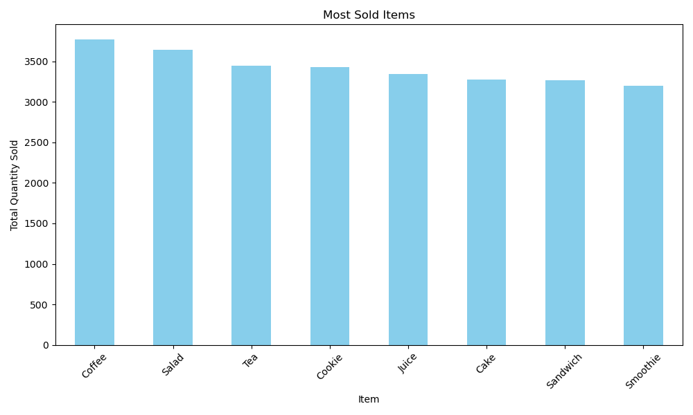
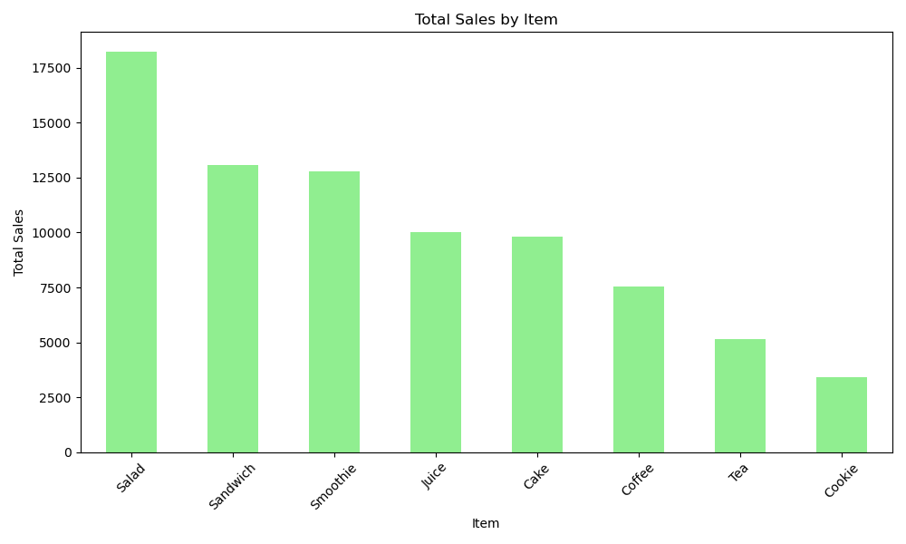
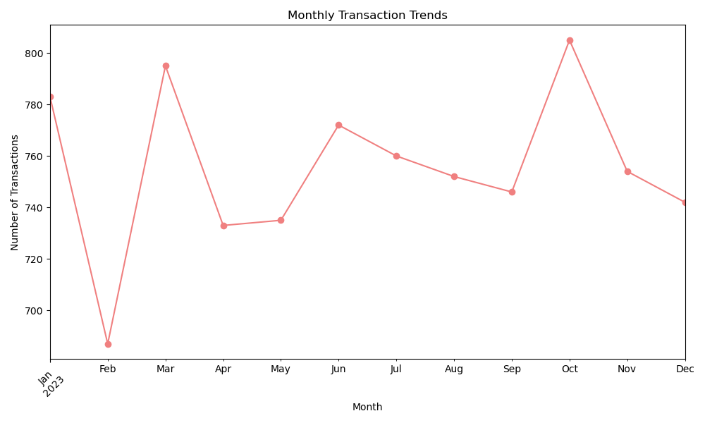
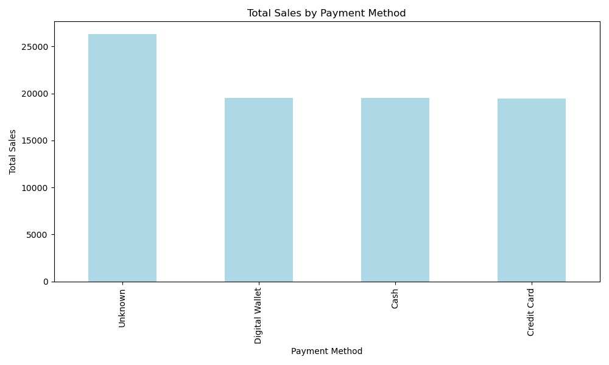
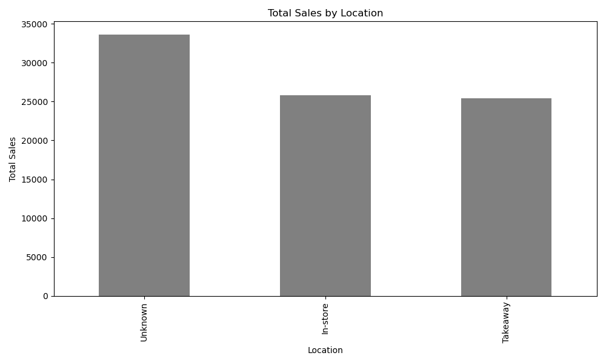

# Cafe Sales – Data Cleaning & Analysis

Cleaning a messy dataset of 10,000 cafe transactions and analysing the clean data with **Python (pandas, matplotlib)**.

## Project structure
```
data/
  dirty/dirty_cafe_sales.csv   ← raw data
  clean/clean_cafe_sales.csv   ← cleaned data
notebooks/
  exploration.ipynb            ← data cleaning
  analysis.ipynb               ← analysis & charts
reports/                       ← saved charts
```

## 1. Data cleaning
The raw data had missing values, invalid entries (`ERROR`, `UNKNOWN`) and wrong data types in almost every column.

| Problem | Solution |
|---|---|
| `ERROR` / `UNKNOWN` values | Treated as missing (`NaN`) |
| Numbers and dates stored as text | Converted to numeric / datetime |
| Missing Quantity, Price or Total | Calculated with **Total Spent = Quantity × Price Per Unit** |
| Missing Price | Filled from the Item (each item has a fixed price) |
| Missing Item | Filled from the price where it is unique, otherwise `"Unknown"` |
| Missing Payment Method / Location | Filled with `"Unknown"` |
| Rows that could not be recovered | Removed (26 with missing numbers, 460 with missing date) |

| | Before | After |
|---|---|---|
| Rows | 10,000 | 9,514 |
| Missing values | many | 0 |
| Rows removed | – | 486 (4.9%) |

## 2. Analysis

### Most sold items vs revenue



**Coffee sells the most units (3,766), but Salad brings the most revenue (18,220 vs 7,532 for Coffee)** because of its higher price (5.0 vs 2.0).

### Monthly transactions


Transactions are stable through 2023, between about 726 (February) and 837 (October) per month.

### Payment method & location



Cash, Credit Card and Digital Wallet bring almost equal revenue, and so do In-store and Takeaway.
A large share is `Unknown`, because these values were missing in the raw data.

## Key findings
- Total revenue: **84,868.50** from 9,514 transactions.
- **Salad** is the top revenue item, **Coffee** the most sold item.
- No payment method or location clearly dominates.

## How to run
```bash
pip install pandas matplotlib jupyter
```
Run `notebooks/exploration.ipynb` first (creates the clean CSV), then `notebooks/analysis.ipynb`.
